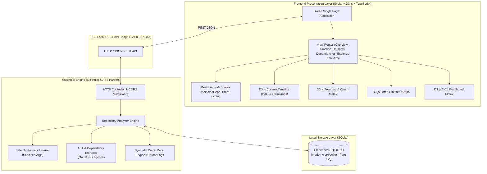
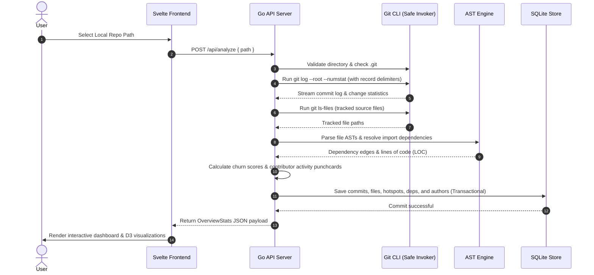
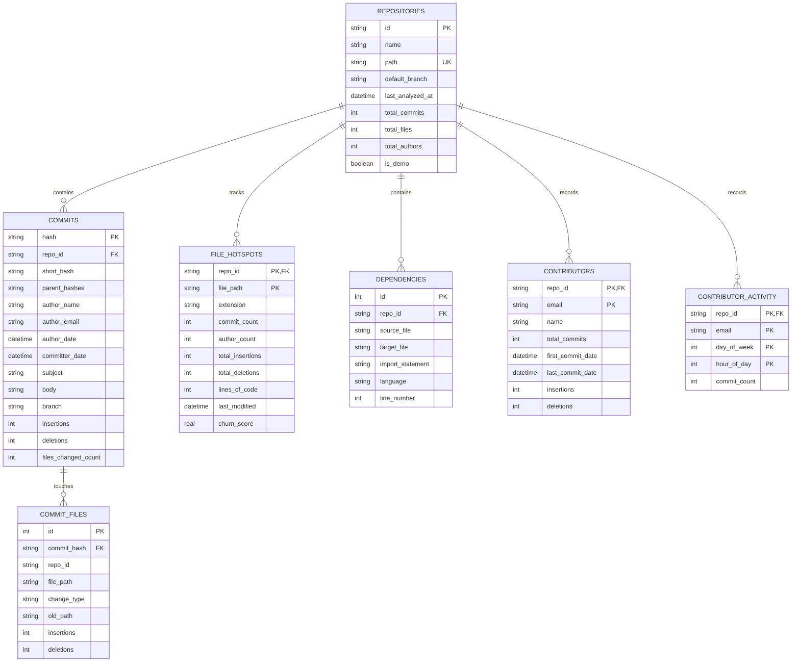

# Commit Archaeologist Architecture Documentation

## 1. High-Level System Architecture

Commit Archaeologist is built on a clean separation of concerns between an **analytical Go backend engine** and a **responsive Svelte frontend shell** styled with modern observability aesthetics.

---

## 2. Analytical Pipeline & Ingestion Flow

When a user opens a local Git directory (or triggers Demo mode):

---

## 3. SQLite Database Schema Design

The persistence layer stores all extracted metrics locally in `~/.archeologist/archeologist.db`:

---

## 4. Architectural Algorithms

### 4.1 Churn Scoring Formula
Hotspots are calculated by combining commit frequency ($C$), author diffusion ($A$), and modification volume ($I + D$):

$$\text{ChurnScore} = (C \times 1.5) + (A \times 2.0) + (\log_2(1 + I + D) \times 1.2)$$

- Files with multiple modifying authors score higher due to increased coordination overhead.
- Logarithmic scaling on total line delta prevents massive generated files or one-off refactors from disproportionately skewing the metrics.

### 4.2 Multi-Language AST Dependency Resolution
- **Go**: Uses `go/parser` and `go/token` to extract import blocks. Internal module package paths (e.g. `myproject/internal/db`) are resolved to physical `.go` files in the repository.
- **TypeScript / JavaScript**: Parses ES6 `import ... from '...'`, `export ... from '...'`, `require('...')`, and dynamic `import('...')`. Relative paths (`./components/Header`) and alias paths (`$lib/`, `@/`) are matched against candidate extensions (`.ts`, `.tsx`, `.svelte`, `.js`, `/index.ts`).
- **Python**: Scans `from <mod> import <sym>` and `import <mod>`. Resolves relative dot notation (`.config`) and package hierarchies (`pkg.subpkg`) to matching `.py` or `__init__.py` files.

---

## 5. Security & Isolation Model

- **Safe Subprocess Execution**: Arguments are passed strictly as formatted slices to `exec.CommandContext()`. No strings are ever passed through a shell interpreter (`cmd.exe` or `/bin/sh`), preventing argument injection vulnerabilities.
- **Air-Gapped Operation**: The Go server binds exclusively to `127.0.0.1`. No data leaves the local machine.
- **AI Opt-in Guarantee**: AI features remain disabled by default with zero external API dependencies.
